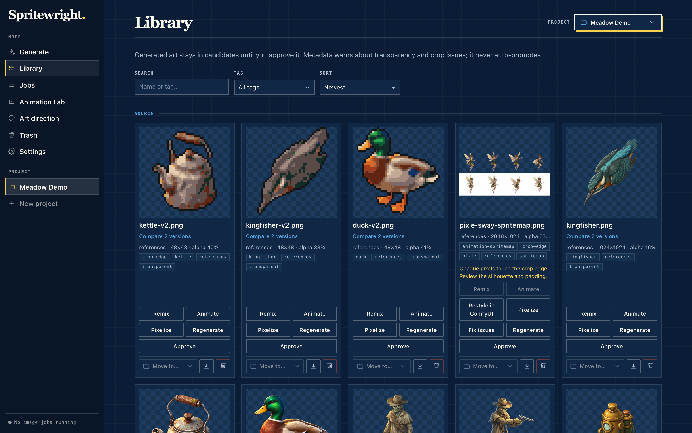
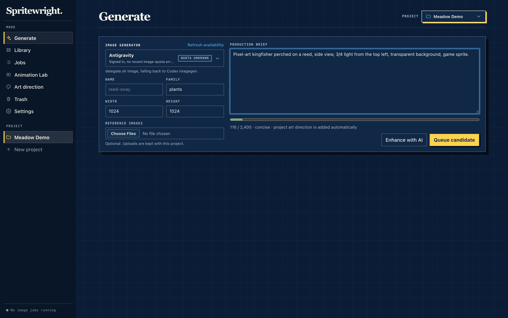
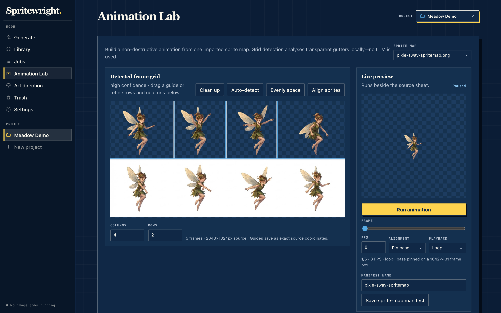
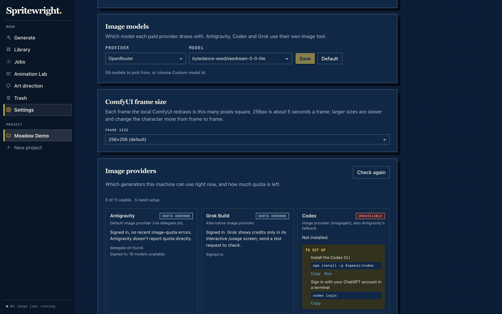

# Spritewright

A local studio for making game sprites and animations with the AI you already pay for.

Hosted sprite tools rent you one model behind a subscription. Spritewright runs on your own machine and uses whatever you already have: a Claude, Codex or Antigravity subscription, API keys for Gemini, OpenAI, OpenRouter or Cloudflare, or a local ComfyUI. It turns prompts into game-ready sprites, cleans them into true pixel art on a fixed palette, builds animations and sprite sheets, and keeps every asset as a candidate until a person approves it.



## Principles

- **Local first.** Your art, prompts and history stay on your disk.
- **Bring your own AI.** No new subscription. Spritewright detects the providers you already have and walks you through setting up the ones you don't.
- **Game-ready output.** Transparent cutouts, fixed palettes, crisp pixel grids, and sprite sheets with atlases, not loose pretty pictures.
- **A person approves.** Nothing is promoted automatically, and every asset records how it was made.

## Screenshots

| Generate | Animation Lab |
|---|---|
|  |  |



## Run locally

Requires Node 22 and pnpm.

```bash
pnpm install
pnpm dev
```

Open [http://127.0.0.1:5173](http://127.0.0.1:5173). The UI talks to a local API on port 4174, bound to `127.0.0.1`.

## Providers

Open **Settings** to see which providers are ready, test them, and follow the setup steps for any that aren't.

| Provider | Kind | Cost |
|---|---|---|
| Antigravity (via [`delegate.sh`](https://github.com/krzysztofradomski/skills)), Codex, Grok Build | Image | Your existing subscription |
| ComfyUI | Image, restyles sprite-map frames | Free, runs locally |
| Google AI Studio, OpenAI, OpenRouter | Image | Pay per image |
| Cloudflare Workers AI | Image, text-to-image only | Free daily allowance, then pay per image |
| Claude (CLI or API) | Text: writes prompts and draws pixel-art SVG | Subscription or pay per prompt |
| Ollama | Text | Free, runs locally |

Paid providers have a daily spending limit ($2 by default), adjustable in Settings.

**API keys** are read from the environment (`GEMINI_API_KEY`, `OPENAI_API_KEY`, `OPENROUTER_API_KEY`, `ANTHROPIC_API_KEY`, `CLOUDFLARE_API_TOKEN` with `CLOUDFLARE_ACCOUNT_ID`) or pasted in Settings, which saves them to `~/.config/<provider>/` in your home directory, never inside the project. The API reports where a key came from, never the key itself.

**ComfyUI** is found at `COMFYUI_DIR`, `~/code/comfy`, `~/comfy`, `~/ComfyUI` or `~/Documents/ComfyUI`, and is expected at `http://127.0.0.1:8188`. It needs an SD 1.5 checkpoint, an OpenPose ControlNet and the OpenPose preprocessor node; Settings lists whatever is missing. Frames render at 256×256 unless you choose a larger size in Settings.

## Workflow

1. **Projects.** Each game is a folder under `games/<game>/assets/`, created from the project switcher. `games/` is ignored by git; symlink an existing art folder there if you have one.
2. **Generate.** Write a brief, or let a text model expand one, then pick a provider. Every request is a separate job that can be cancelled or retried, and failures keep their log.
3. **Review.** New images land in `candidates/` beside a JSON manifest recording the prompt, provider, version, lineage, alpha coverage, crop and checksum. Moving an asset to `approved/` is always a person's decision. Deleted assets and projects go to a trash you can restore from.
4. **Pixelize.** Turns any asset into true pixel art: snaps it to a grid, hardens alpha, maps colours to the project palette in OKLab, removes stray pixels and adds an outline. The first pixelized asset sets the project's palette, so later ones match it. Grid size, colour count and outline are project settings.
5. **Animate.** Arrange frames from a sprite map or from separate images, preview the loop, and adjust motion presets. Export a PNG sprite sheet, a TexturePacker/Phaser JSON atlas and an animated WebP preview, optionally scaled up by a whole number for pixel art.

## Data

Runtime state lives in `data/` (jobs, provider checks, settings, uploads) and art in `games/`. Both are ignored by git, so the repository holds only code.

## Development

```bash
pnpm test
```

```bash
pnpm typecheck
```

```bash
pnpm lint
```
